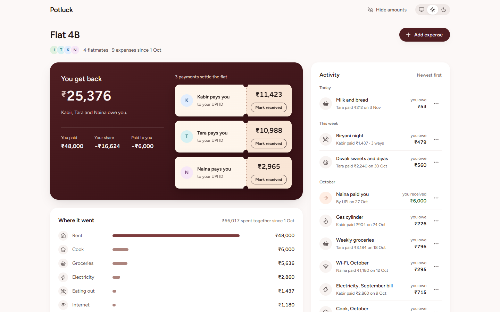
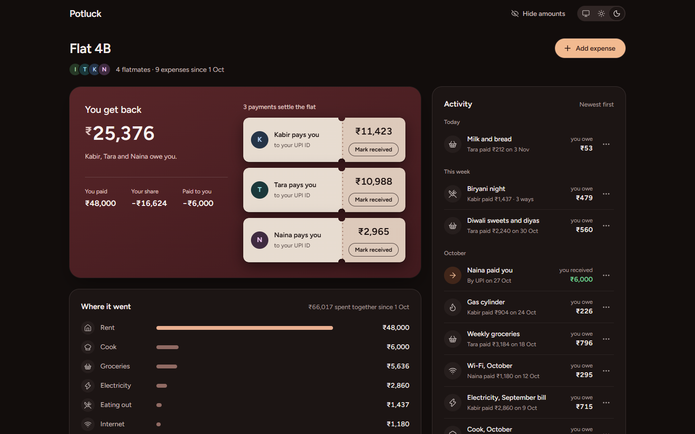
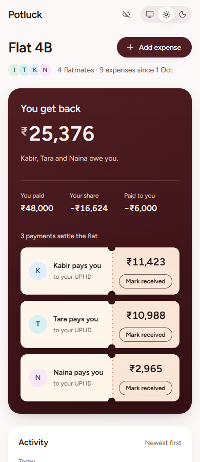
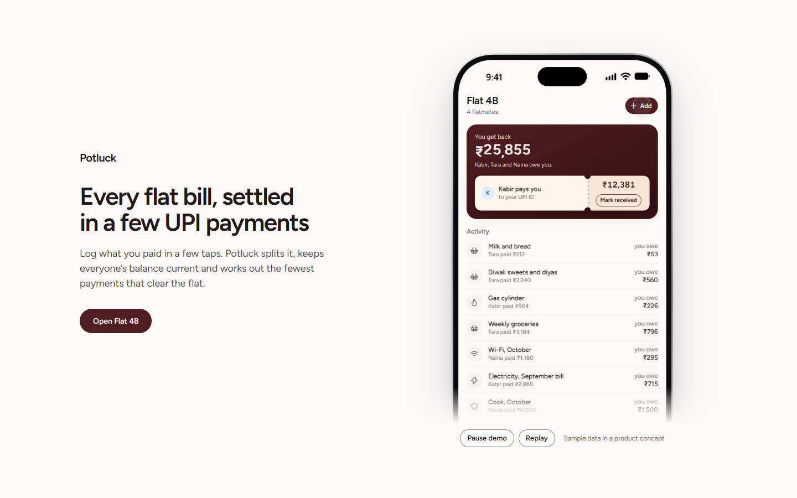
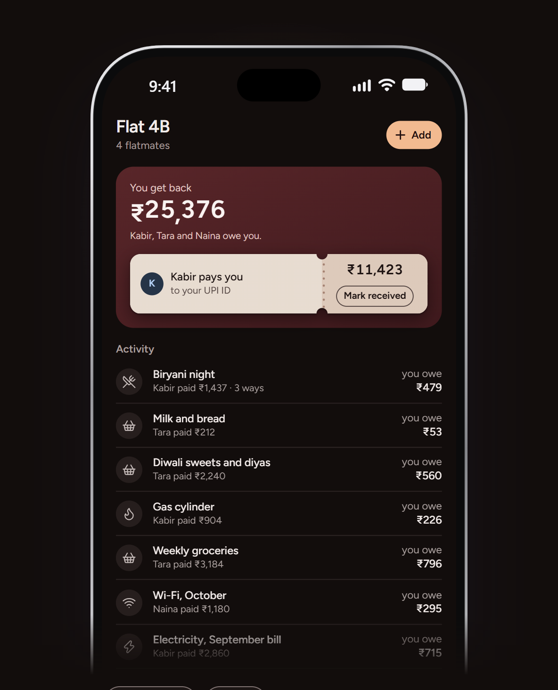

# Potluck

**A shared-bills app for flatmates and trip groups in India.** Log what you paid in seconds, see who owes whom at a
glance, and settle up in the fewest UPI payments. Settle-up payments appear as tear-off paper chits inside your balance.



## What it is

- **Clickable app** (`app/index.html`): your balance with the working shown (paid − share − received), settle-up chits
  with "Mark received" and undo, spending by category, the activity list with delete and undo, an add-expense dialog
  with validation, hide amounts, and a System / Light / Dark switch.
- **Self-playing demo** (`app/demo.html`): "add an expense, see it settle" on a phone, for a landing-page hero.
- **One page with both** (`app/showcase.html`, built into `publish/potluck.html`), switched by `#app` / `#demo`.

## Who it's for

Flatmates in their twenties who share rent, groceries and trips, check a few times a week on a phone, and settle up at
the end of the month.

## Status

A design **prototype**. No payment is ever made: settling only records "Mark received". There is no server and no
sign-in; the data is a fixed sample of four invented flatmates. Checked at desktop and phone sizes in light and dark;
not yet tested on a real touch device, with a screen reader or with very long names. The demo deliberately plays in
full even when the system asks for reduced motion. Details in [design-notes/potluck.md](design-notes/potluck.md).

## Privacy

Everything runs in your browser and nothing is sent to a server. The only thing stored is your theme choice (browser
local storage). The people, expenses and UPI IDs (on example domains) are invented.

## Built with

React 19, TypeScript, Vite 8, Base UI (dialog, menu), Number Flow (rolling figures), AutoAnimate, Sonner (undo
toasts), lucide-react icons, Figtree (bundled via Fontsource). The demo uses a small demo kit of my own, vendored in
`app/src/kit/`.

## Run it

```sh
cd app && npm install && npm run dev
```

Then open http://127.0.0.1:5190/ (app) or http://127.0.0.1:5190/demo.html (demo). `npm run build` type-checks and
builds both to `app/dist/`; `npm run preview` serves the build. `?theme=light|dark` shows one theme without saving it.

**Single-file page:** `publish/potluck.html` is self-contained (fonts inlined, no outside requests); it is the page body
without an `<html>`/`<head>` wrapper, made for embedding. To rebuild it: `npm run build:showcase` in `app/`, then
`python -I package_showcase.py` here.

## Screenshots

| | |
|---|---|
|  |  |
|  |  |

More: [demo key states](docs/screenshots/demo-states-1440.png)

## How it was designed

- [design-notes/direction.md](design-notes/direction.md): the brief, the five lines, the candidates and the direction
  "kitchen-table chit".
- [design-notes/potluck.md](design-notes/potluck.md): assumptions, applied rules, checks, the five review rounds, the
  score and what was not checked.

## Licence

MIT, see [LICENSE](LICENSE). Copyright (c) 2026 Ankeet Panda.

## Third-party notices

- **Figtree** font by The Figtree Project Authors (Erik Kennedy), SIL Open Font License 1.1.
  Source: https://github.com/erikdkennedy/figtree, installed from npm as `@fontsource-variable/figtree` and inlined as
  data in `publish/potluck.html`. The font is not covered by this repository's MIT licence.
- Icons: [Lucide](https://lucide.dev) (ISC licence), via `lucide-react`; also inlined in `publish/potluck.html`.
- npm packages keep their own licences (React, React DOM, Base UI, Number Flow, AutoAnimate and Sonner: MIT).

Full third-party licence texts are in [licenses/](licenses/).
